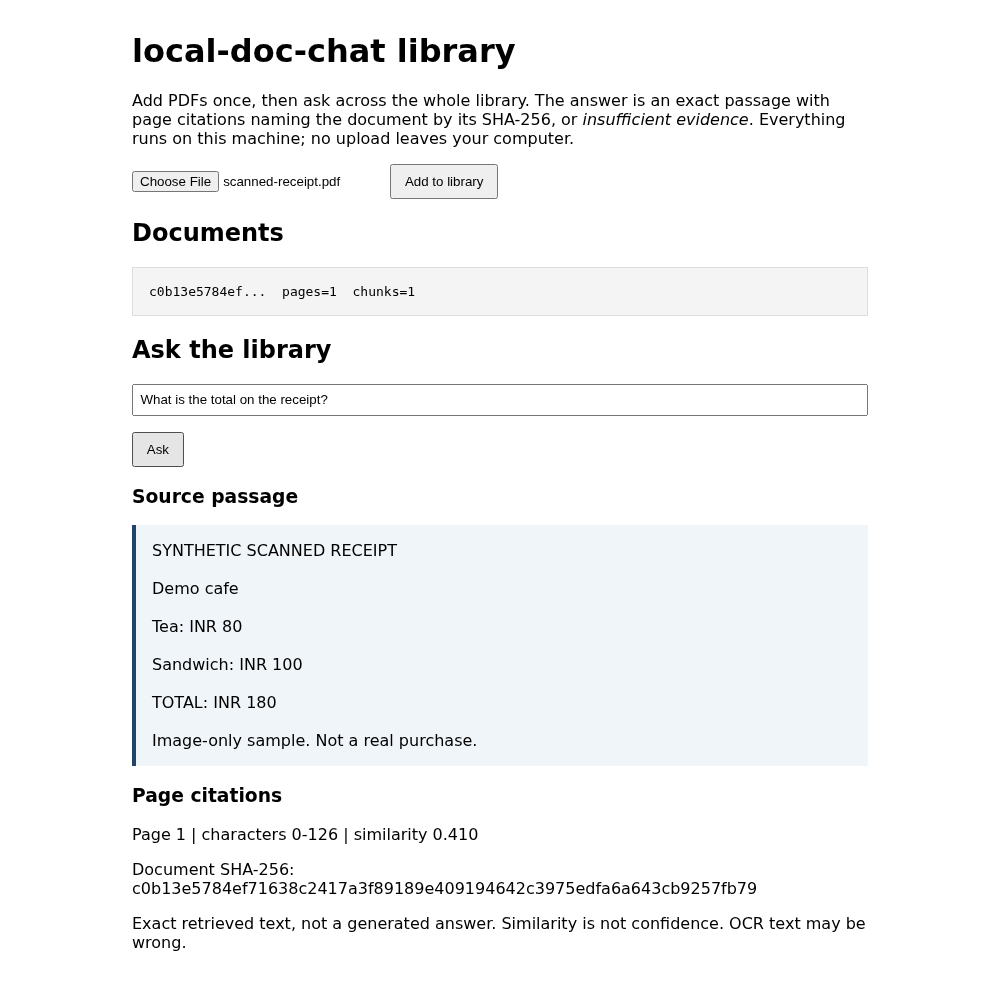
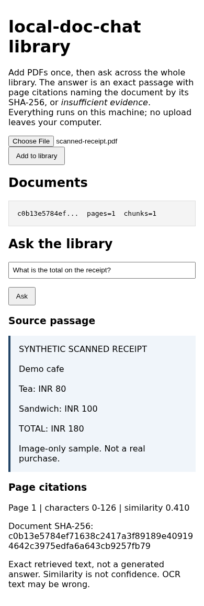
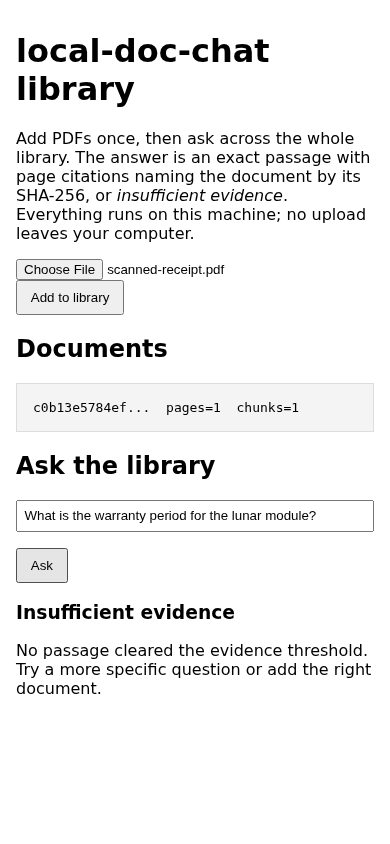
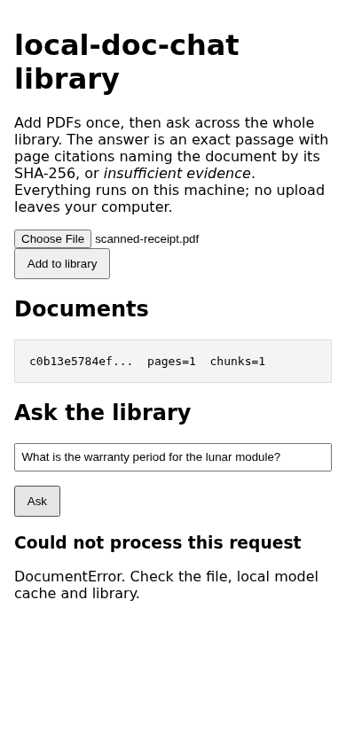

# Portfolio release closeout

23 November 2026. This closes the planned **local PDF/scan evidence-Q&A**
feature work, with limitations stated below. It does not reclassify the
experimental image client as verified generative vision/chat.

## Acceptance contract

1. Fresh Python environment can install the complete dependency set and run
   all 124 tests. Tesseract-English integration test runs if installed.
2. A synthetic text policy and image-only receipt can be added to a persistent
   library; real local CPU embeddings are used, with English OCR for the scan.
3. The receipt question returns an exact INR180 passage with page1/hash
   citation. The policy question returns page2 after reopening the store.
4. The absent question abstains, malformed uploads fail, and re-addition reuses
   vectors when extraction matches.
5. Browser users see passages and citations, not raw JSON, on phone and desktop.
   OCR warnings, insufficient evidence and error states are visible. HTML-like
   text remains inert text.
6. API rejects invalid requests, caps actual streamed uploads, does not run
   blocking library adds on the event loop, and returns no submitted values
   in validation details. The process lock is not multi-process safety.

## Evidence

- `eval/release_check.py` and `eval/release-results.json`: real OCR/MiniLM
  acceptance, run offline with an already downloaded model. Two synthetic
  PDFs only, not an accuracy benchmark.
- All five earlier evaluation scripts rerun offline without regressions.
- Complete install in a new Python3.10 virtual environment; `pip check`
  reports no broken requirements. Fresh-clone verification is part of the
  release handoff; remote CI success is not assumed from a workflow file.
- Actual headless Chrome at 1000px and390px: OCR upload, receipt answer,
  absent question, malformed upload error; no JavaScript errors. DOM check
  confirmed an HTML-like excerpt does not create an image element.

## Implementation changes

- New `ocr.py`: render textless physical pages at150DPI, English Tesseract
  subprocess without a shell, timeout and output bounds, cleanup on failure.
  Ten-page OCR cap, combined character cap and render-pixel guards. Not a
  hostile-file sandbox. Tesseract engine and data are separate installations.
- Library opt-in `ocr=True` / CLI `--ocr`, persisted attempted-OCR page
  metadata and extraction-mode cache checks. Existing text-only caches still
  load. OCR-mode re-add repairs formerly empty scan caches. OCR text/offsets
  remain fallible and should be compared with the original page.
- Validate new vectors before cache writes, account for replacement chunks
  in the global cap, avoid loading the model for an empty-library question.
- UI uses DOM textContent for passages/citations and preserves line breaks.
- API strict JSON validation and bounded streaming, content-length mismatch
  rejection, background-thread execution of blocking document adds.
- `requirements-all.txt`, Makefile, CI template (not an active workflow) and replacement README
  with actual working path, limits and sample acceptance questions.

## Not included

Verified generative vision/chat inference, handwriting recognition, mixed
text/image-page OCR, general retrieval accuracy, laptop GPU execution, hosted
inference, public deployment, authentication, TLS, multi-user operation,
parser sandboxing, multi-process storage safety and performance benchmarks.
These are explicit boundaries, not unfinished work silently claimed complete.
The model revision is not hard-pinned by the runtime; stored vector caches are
trusted local files, not authenticated data.

## Interview questions

- Why can a strict Content-Length precheck still require a streaming byte cap?
- Why move CPU/blocking add work off an ASGI event loop, and why does that not
  make the embedding engine or store safe for multiple processes?
- What changes when citation offsets refer to OCR output instead of extracted
  PDF text? Why is page/hash provenance necessary but not sufficient?
- Why doesn't one correct synthetic receipt establish OCR accuracy?
- What does content hashing prevent, and what does an attacker with local
  cache-write access still control?

## External references checked during closeout

- Tesseract manual and engine license: https://tesseract-ocr.github.io/tessdoc/
- Installation: https://tesseract-ocr.github.io/tessdoc/Installation.html
- Apache-2.0 license: https://raw.githubusercontent.com/tesseract-ocr/tesseract/main/LICENSE
- Blocking endpoint/thread-pool behavior: https://www.starlette.io/threadpool/

The push credential cannot install GitHub workflows. The CI example is saved
as `docs/ci/tests.yml.example`; no token/account permission changes were made.
